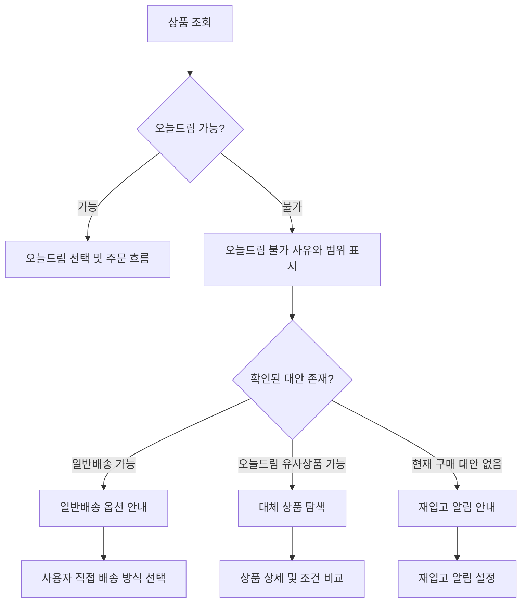

# Olive Young 오늘드림 UX 개선 — Mobile Design System v1.0

> **문서 성격:** 비공식 모바일 UX/UI 개선 프로젝트용 디자인 시스템 제안서  
> **기준 자료:** 첨부 `DESIGN_SYSTEM.md` (2026-07-13 PC 웹 스토어 및 기업 홈페이지 관찰 자료)  
> **작성일:** 2026-11-16  
> **적용 범위:** iOS·Android 모바일 프로토타입, 오늘드림 일시품절 대응 흐름  
> **주의:** 실제 올리브영 앱의 공식 토큰·운영 정책·재고/배송 약속을 대변하지 않음.

---

## 0. 문서를 읽는 방법: 근거 레벨

모든 규칙은 다음 중 하나로 구분한다.

- **[O] Observed / 관찰:** 원본 `DESIGN_SYSTEM.md`에서 실제 PC 웹/기업 화면으로 확인된 값. 모바일에서 동일하게 쓰인다는 의미는 아님.
- **[P] Proposed / 제안:** 이번 모바일 개선 시안을 위해 신규 정의한 디자인 결정. 사용자 테스트·실제 앱 대조 전 변경 가능.
- **[V] Verify / 검증 필요:** 공식 모바일 앱, 실제 상품·지역별 배송 정책 및 사용성 테스트로 확인해야 하는 사항.

**제품 화면은 [O] 값을 무조건 복제하지 않고, [P] 모바일 토큰으로 매핑해 사용한다.** 기업 페이지의 Olive Green을 실제 앱의 주 CTA 컬러로 확정하지 않는다.

## 1. 목표와 설계 원칙 [P]

**프로젝트 문제:** 사용자가 원하는 상품의 `오늘드림 일시품절`을 발견했을 때 재입고 알림만 제시되면 지금 구매할 수 있는 다른 방법을 파악하기 어렵다.

**목표:** (1) 어떤 배송 옵션이 불가능한지 명확히 알리고, (2) 지금 가능한 대안을 비교하며, (3) 사용자가 자신의 목적에 맞게 다음 행동을 선택하도록 돕는다.

1. **상태 먼저:** `오늘드림 불가`와 `상품 전체 품절`을 혼동시키지 않는다.
2. **대안을 바로 옆에:** 일반배송, 유사한 오늘드림 가능 상품, 재입고 알림 중 실제 이용 가능한 선택지만 노출한다.
3. **선택권 유지:** 사용자가 의도하지 않은 배송 방식으로 자동 전환하지 않는다.
4. **문구는 구체적으로:** 불가능한 이유가 확인되지 않으면 재고/배정 원인을 단정하지 않는다.
5. **접근성 우선:** 색상만으로 상태를 구분하지 않고 문구·구조·접근 가능한 터치 영역을 함께 제공한다.
6. **단계적 공개:** 상품 카드에는 핵심 상태만, 상세화면에는 조건·대안·세부 안내를 배치한다.

## 2. 기반으로 사용할 PC 웹 관찰값 [O]

### 2.1 컬러

| 원본 역할 | 값 | 원본 근거와 제한 |
|---|---|---|
| Storefront Canvas | `#FFFFFF` | PC 스토어 배경 |
| Storefront Ink | `#131518` | PC 검색 입력 텍스트 |
| Storefront Body | `#666666` | PC 본문·기본 계층 |
| Storefront Muted | `#888888` | PC 비활성 캐러셀 글자 |
| Storefront Line | `#EBEBEB` | PC 찜 버튼 테두리 |
| Storefront Current | `#2F3030` | PC 캐러셀 활성 항목 |
| Corporate Brand Green | `#82DC28` | **기업 홈페이지 관찰값**, 스토어 주 CTA 확정값 아님 |
| GNB Hover/Pressed | `#E02020` | **PC GNB 텍스트에만** 관찰된 상태값 |

### 2.2 타이포그래피

| PC 관찰 역할 | 폰트 | 사이즈/굵기/줄높이 | 참고 |
|---|---|---|---|
| 스토어 본문 | Montserrat | 14px / 400 / 20px | 자간 -0.56px |
| 메인 GNB | Montserrat | 16px / 700 / 44px | PC 메뉴 링크, 모바일 GNB 규칙 아님 |
| 캐러셀 페이지 | Montserrat | 14px / 700 / 24px | PC 선택 항목 |
| 기업 페이지 디스플레이 | CJONLYONENew | 25.2px / 700 / 35.28px | 스토어 시스템과 분리 |
| 검색 입력 | Arial (시스템 해석) | 14px / 400 / 20px | 원본 입력 자체의 값 |

원본에 선언만 있고 사용이 확인되지 않은 Pretendard, OY Greta Sans 등의 폰트는 공식 앱 폰트로 간주하지 않는다. 웹폰트 제공과 외부 파일 재사용 권리는 별개다.

### 2.3 원본 컴포넌트 크기

| 컴포넌트 | PC 관찰값 | 모바일 적용 판단 |
|---|---|---|
| 검색 입력 | 294×38px, 안쪽 좌14/우10px, radius 5px | 모바일 너비/터치 영역 재설계 |
| 찜 버튼 | 40×40px, 테두리 `#EBEBEB`, radius 0px | 터치 영역 확장 검토 |
| 상품 썸네일 | 215×215px, radius 0px | 정사각 비율만 참고, 크기 유동화 |
| 아웃라인 버튼 | 335×40px, 테두리 `#DDDDDD`, radius 4px | 폭/높이 모바일화 |
| 캐러셀 활성 항목 | 24×24px, `#2F3030`, 흰색, radius 12px | 시각 인디케이터로만 참고 |
| GNB | 높이 44px, hover/pressed `#E02020` | 모바일 터치 내비게이션으로 재설계 |

**원본에서 확인되지 않음:** 모바일 레이아웃·앱 컴포넌트, 재고 안내, 상품 상세, 장바구니/결제, 알림 토스트, disabled/error/loading/focus-visible, 모션 수치 및 반응형 breakpoint.

---

## 3. 모바일 Foundation [P]

### 3.1 컬러 토큰

기존 PC 웹의 중립 색상은 가능한 한 보존하되, UI 상태용 역할을 구분한다.

| Semantic token | 제안 값 | 용도 | 출처 |
|---|---|---|---|
| `color.bg.canvas` | `#FFFFFF` | 기본 배경 | [O] 매핑 |
| `color.bg.subtle` | `#F7F8F7` | 안내 영역, 보조 그룹 | [P] |
| `color.text.primary` | `#131518` | 상품명·주요 정보 | [O] 매핑(원본은 검색 텍스트) |
| `color.text.secondary` | `#666666` | 부가 설명 | [O] 매핑 |
| `color.text.tertiary` | `#757575` | 보조 메타 정보 | [P]; 가독성 기준으로 조정 |
| `color.border.default` | `#EBEBEB` | 일반 구분선 | [O] 매핑 |
| `color.border.strong` | `#DDDDDD` | 아웃라인 버튼 | [O] 컴포넌트 값 매핑 |
| `color.action.primary.bg` | `#2F3030` | 프로젝트의 기본 CTA | [P]; PC 캐러셀 색을 재사용할 뿐 공식 CTA 아님 |
| `color.action.primary.fg` | `#FFFFFF` | CTA 레이블 | [P] |
| `color.action.secondary.bg` | `#FFFFFF` | 보조 버튼 | [P] |
| `color.brand.reference` | `#82DC28` | 기업 브랜드 참고/제한적 장식 | [O] 기업 페이지, 앱 CTA로 사용 확정 금지 |
| `color.status.unavailable` | `#B42318` | 오늘드림 불가 텍스트 | [P] |
| `color.status.unavailable.bg` | `#FFF3F1` | 품절 안내 배경 | [P] |
| `color.status.available` | `#167347` | 현재 선택 가능 상태 | [P] |
| `color.status.available.bg` | `#ECF8F0` | 가능 상태 배경 | [P] |
| `color.status.info` | `#2457A7` | 일반배송 등 안내 | [P] |
| `color.status.info.bg` | `#F0F5FF` | 정보 안내 배경 | [P] |
| `color.focus.ring` | `#2457A7` | 키보드/보조기술 포커스 | [P] |

- 상태색은 **텍스트·아이콘·배경의 복합 표현**에만 사용한다. 필수 텍스트 대비는 최종 컴포넌트별로 점검한다.
- `#82DC28` 위에 작은 흰색 텍스트를 올리는 용도는 피한다. 색상 브랜드 연상과 버튼 가독성은 별도 문제다.
- 원본의 `#E02020`은 PC GNB hover 값일 뿐 모바일 품절색 토큰으로 복제하지 않는다.

### 3.2 타이포그래피

**프로젝트 폰트:** 한국어 UI에는 `Pretendard` 사용을 **제안**하되 해당 선택은 공식 올리브영 앱 폰트 추정이 아니다. 영문/숫자에서 Montserrat가 필요하면 에셋 라이선스 및 실제 배포 환경을 먼저 확인한다. 시스템 폰트 대체도 허용한다.

| Token | Size | Weight | Line-height | 사용 |
|---|---:|---:|---:|---|
| `type.pageTitle` | 24px | 700 | 32px | 페이지 상단 제목 |
| `type.sectionTitle` | 20px | 700 | 28px | 큰 콘텐츠 그룹 |
| `type.cardTitle` | 16px | 600 | 24px | 상품명/추천 제목 |
| `type.body` | 14px | 400 | 20px | 일반 설명 |
| `type.bodyStrong` | 14px | 600 | 20px | 강조 설명 |
| `type.label` | 13px | 600 | 18px | 배송/재고 상태 |
| `type.caption` | 12px | 400 | 18px | 부가 설명(필수 핵심정보에는 남용 금지) |
| `type.button` | 16px | 600 | 24px | 주요 CTA |
| `type.price` | 20px | 700 | 28px | 주요 가격 |

- 기본 자간은 `normal`로 시작하고 실제 한국어 렌더링에서 조절한다. PC의 -0.56px을 모든 모바일 텍스트에 강제하지 않는다.
- 사용자가 OS 글자 크기를 키워도 잘리거나 버튼 문구가 소실되지 않도록 테스트한다.
- 핵심 품절 문구/CTA는 축약으로 의미가 바뀌지 않도록 한다.

### 3.3 Spacing / Grid / Radius

| Token | 값 | 사용 |
|---|---:|---|
| `space.1` | 4px | 아이콘·텍스트 작은 간격 |
| `space.2` | 8px | 연관 항목 내부 간격 |
| `space.3` | 12px | 카드 내부 요소 간격 |
| `space.4` | 16px | 기본 화면 좌우 여백, 카드 padding |
| `space.5` | 20px | 그룹 안쪽 간격 |
| `space.6` | 24px | 섹션 간 간격 |
| `space.8` | 32px | 주요 섹션 분리 |
| `radius.none` | 0px | 이미지 비율/사각 요소 유지 |
| `radius.sm` | 4px | 기존 아웃라인 느낌 |
| `radius.md` | 8px | 모바일 안내 카드/버튼 |
| `radius.lg` | 12px | 패널/바텀시트 내부 카드 |
| `radius.pill` | 999px | 상태 칩(제안) |

- 기본 화면 좌우 inset: 16px; 큰 화면에서는 20~24px 선택 가능.
- 상품 리스트는 기기 폭에 따라 2열 그리드를 기본 검토; 너무 좁은 기기는 카드 최소 너비/텍스트 줄바꿈을 기준으로 재평가한다.
- Safe area(상단 notch, 하단 home indicator)를 침범하지 않는다.
- 320/360/390/430px 화면 너비는 **QA 테스트 샘플**이지 실제 공식 앱 breakpoint가 아니다.

### 3.4 Elevation / Motion

- 기본적으로 border와 공간으로 계층을 분리한다. 원본 PC 스토어 여러 컨트롤에서 box-shadow 없음이 관찰됨 [O].
- 스티키 하단 행동 영역은 `1px` 상단 구분선 또는 약한 그림자 중 한 방식만 사용 [P].
- 상태 변경 애니메이션은 짧고 과하지 않게 설계; 구체적 duration/easing은 [P]이며 `prefers-reduced-motion` 지원을 검증한다.

### 3.5 터치·접근성

- 터치 가능 영역은 최소 44×44pt(iOS 프로젝트 기준) 또는 48×48dp(Android 프로젝트 기준)를 목표로 한다 [P]. 실제 시각 아이콘은 더 작아도 터치 컨테이너는 확보한다.
- 본문 일반 텍스트는 WCAG AA 4.5:1, 큰 텍스트는 3:1, 의미 있는 비텍스트 경계는 3:1을 목표로 검증한다.
- 포커스 순서, 스크린리더 설명, 상태 변경 공지(예: 알림 설정 완료), 확대 글자 및 화면 회전/리사이즈에 대응한다.
- `색상 + 텍스트`, 필요시 아이콘으로 재고 상태를 표기한다.

---

## 4. 모바일 컴포넌트 규격 [P]

### 4.1 Button

| Variant | 높이 | 배경 / 텍스트 | 외곽 / Radius | 사용 |
|---|---:|---|---|---|
| Primary | 52px | `#2F3030` / white | 없음 / 8px | 이용 가능한 우선 행동 1개 |
| Secondary | 48px | white / `#131518` | `#DDDDDD` 1px / 8px | 일반배송 보기 등 |
| Text | 최소 44px 터치 | transparent / `#131518` | 없음 | 재입고 알림 관리 등 |
| Disabled | 52px | 제안 중립 회색 / 대비 확보된 텍스트 | 8px | 행동 자체가 불가능할 때만 |

**상태:** default, pressed, focus-visible, loading, disabled, success(동작 후 피드백)를 개별 정의한다. `disabled` 시 불가능 사유를 주변 문구로 설명한다. 품절일 때 상품 전체의 탐색까지 막지 않는다.

### 4.2 Search field

- 높이 48px, 너비 `100%`, radius 8px, 아이콘/텍스트 간격 8px.
- 입력/초점/검색어 있음/검색 결과 없음/지우기 동작 정의.
- 기존 PC 38px 높이와 14px/10px padding은 **참고값**이지 모바일 규격이 아님.
- 모바일 키보드 등장 시 하단 CTA·결과 리스트가 가려지지 않도록 검증.

### 4.3 Product card

- 2열 그리드 기준 썸네일 **1:1** 비율, 유동 너비. 이미지 자체의 라운드는 0px 또는 4px 중 하나로 시안에서 통일.
- 순서: 이미지 → 브랜드/상품명 → 가격 → 배송 가능성 → 보조 행동(필요시).
- 상품명은 2줄까지 표기하고 긴 이름은 생략 처리하되 상세 접근 경로 보장.
- 찜 버튼은 아이콘을 카드 상단 모서리에 둘 수 있지만 독립 터치 영역 최소 크기를 확보.
- 재고 여부를 상품 전체의 비활성 오버레이로만 표현하지 않는다. 상품명·가격·일반배송 가능 여부는 계속 읽을 수 있게 한다.

### 4.4 Availability badge / delivery option

| 상태 ID | 표시 문구 예시 | 시각 역할 | 사용자에게 보장하는 정보 |
|---|---|---|---|
| `today.available` | 오늘드림 가능 | available | 조회한 조건에서 현재 가능으로 보임; 최종 주문 확정 아님 |
| `today.unavailable` | 오늘드림 일시품절 | unavailable | 해당 조건의 오늘드림 선택이 현재 불가 |
| `standard.available` | 일반배송 구매 가능 | info | 일반배송 선택 가능(실제 상품 조회 결과 필요) |
| `standard.unavailable` | 일반배송 품절 | unavailable | 일반배송도 구매 불가 |
| `availability.unknown` | 배송 가능 여부 확인 필요 | neutral | 데이터 미수신·지역 조건 미확정 |
| `availability.checking` | 배송 가능 여부 확인 중 | neutral/loading | 조회 진행 중 |

**상태 판단 기준:** 반드시 상품/옵션/수량/배송지/조회 시점에 연결한다. 오늘드림 품절을 특정 매장 한 곳의 품절로 단정하지 않는다 [V].

### 4.5 Inline notice / feedback

- `Notice`: 상태 제목 1줄 + 이유/범위 설명 1~2줄 + 가능한 행동 링크/버튼 1개.
- `Toast`: 알림 설정 등 동작이 성공했음을 짧게 확인. 중요한 상태 변경은 화면 내에서도 지속적으로 확인 가능하게 한다.
- `Error`: 네트워크 실패와 실제 품절을 다르게 표시한다.
- `Bottom sheet`: 배송 옵션 비교나 알림 조건 설명이 필요한 경우에 한해 사용하며, 닫기/뒤로가기/키보드/스크린리더를 지원.

### 4.6 Sticky bottom action area

- 화면 좌우 16px, 위·아래 적절한 padding, safe area 반영.
- 우선 CTA 최대 1개 + 보조 CTA 최대 1개를 기본 원칙으로 하되 실제 선택지 수와 문맥에 따라 조정.
- 화면 중앙 콘텐츠와 겹치지 않도록 본문 하단 padding 확보.
- `오늘드림 일시품절` 상황에서 불가능한 `오늘드림 구매`를 활성화하지 않는다.

---

## 5. 오늘드림 품절 UX 패턴 [P]

### 5.1 사용자 흐름



흐름도 분기는 동시에 여러 대안을 제공할 수 있다. 반드시 하나만 선택하도록 강제하는 의미가 아니다.

### 5.2 정보 우선순위

1. **현재 상태:** `오늘드림 일시품절`.
2. **범위/조건:** 선택한 배송지 기준 등 실제 확인 가능한 정보만 사용 [V].
3. **가장 가까운 대안:** `일반배송으로 구매`, `오늘드림 가능한 비슷한 상품 보기` 중 실제 이용 가능한 항목.
4. **기다리는 대안:** `재입고 알림 받기`.
5. **조건 변경 경로:** 배송지 변경/상품 옵션 변경 등 실제 앱에서 허용하는 동작만 노출 [V].

### 5.3 상품 상세 페이지의 예시 UI 카피

> **오늘드림은 현재 이용할 수 없어요**  
> 선택한 배송 조건에서 오늘드림 주문이 어려워요.  
> **[일반배송으로 구매]** (일반배송이 실제 가능한 경우만 표시)  
> **[오늘드림 가능한 비슷한 상품 보기]** (조회 결과가 존재하는 경우)  
> **[재입고 알림 받기]** (지원되는 경우)

- 사용자가 배송 방식을 바꾸면 **배송 예정 일정·배송비·주문 조건**이 변경될 수 있음을 실제 확인 값으로 표시한다.
- 사용자에게 확인되지 않은 `몇 시간 내 도착`, `재입고 예정`, `근처 매장에 재고 있음` 등의 표현은 사용하지 않는다.

### 5.4 재입고 알림 상태 머신

| 상태 | 표시 | 행동 |
|---|---|---|
| 미설정 | `재입고 알림 받기` | 알림 설정 시도 |
| 설정 중 | `알림 설정 중…` | 중복 요청 방지 |
| 설정 완료 | `재입고 알림이 설정됐어요` | `알림 설정됨`으로 화면 상태 유지 |
| 이미 설정 | `알림 설정됨` | 지원 시 해제/관리 제공 |
| 설정 실패 | `알림 설정에 실패했어요` | 다시 시도/오류 안내 |
| 지원 불가 | `이 상품은 재입고 알림을 제공하지 않아요` | 다른 대안 제공 |

푸시 수신 동의, 재입고 알림의 대상(상품/옵션/배송), 실제 알림 시점/유효기간은 [V]. 단순 토스트만으로 설정 상태가 사라지지 않게 설계한다.

### 5.5 재고/배송 엣지 케이스

| 상황 | UX 처리 |
|---|---|
| 조회 중 품절로 변경 | 낡은 가능 상태를 유지하지 말고 다시 조회하고 변경 사실 안내 |
| 오늘드림 불가 + 일반배송 가능 | 구분 표시, 사용자가 직접 일반배송 선택 |
| 오늘드림 불가 + 일반배송 불가 | 대체 상품과 알림 중심으로 안내 |
| 배송지 미설정 | 배송지 설정 후 가능 여부 확인하도록 유도 |
| 옵션별 재고 다름 | 색상/용량/수량별 배송 가능 여부 구분 |
| 네트워크 오류 | `품절`로 오인하지 않도록 `조회 실패` 표시 |
| 대체 상품 없음 | 빈 결과 이유 안내 + 검색/뒤로가기 제공 |
| 알림 권한 거부 | 설정 가능 여부 안내; OS 권한 요청은 적절한 시점에만 |
| 배송 방식 변경 후 가격/혜택 상이 | 변경 전후 조건을 명시적으로 비교 |
| 스크린리더 사용 | `오늘드림 일시품절, 일반배송 구매 가능`처럼 상태와 대안을 읽어 줌 |

---

## 6. 반응형·플랫폼 운영 규칙 [P]

| 체크 포인트 | iOS | Android |
|---|---|---|
| 단위 | pt 기반 설계 및 화면 스케일 확인 | dp/sp 기반 설계 |
| 터치 영역 목표 | ≥44×44pt | ≥48×48dp |
| 시스템 글자 확대 | Dynamic Type 대응 | 글꼴 크기/디스플레이 확대 대응 |
| 하단 고정 영역 | Home indicator safe area | 시스템 내비게이션 영역 및 gesture inset |
| 뒤로가기 | 상단 뒤로가기/제스처 | 시스템 뒤로가기/제스처 |
| 입력 중 키보드 | 하단 CTA 가림 여부 테스트 | IME 인셋/리사이즈 테스트 |

UI 화면 시안은 390px 너비를 기본으로 시작할 수 있지만, 320/360/390/430px에서 상품명 잘림, 카드 너비, CTA 높이 및 하단 영역 겹침을 테스트한다. 기기별 실제 px ↔ pt/dp 매핑은 사용 환경에 따라 달라진다.

## 7. 개발 및 Figma 네이밍 가이드 [P]

**Figma 컬렉션 예시**

- `Core/Colors`: primitive palette
- `Semantic/Colors`: `text.primary`, `status.unavailable`, `action.primary.bg` 등
- `Foundation/Typography`: `pageTitle`, `body`, `label`, `button`, `price`
- `Foundation/Spacing`: `space.1`, `space.2`, …
- `Components/Button`: `variant=primary|secondary|text`, `state=default|pressed|focus|loading|disabled`
- `Components/AvailabilityBadge`: `service=today|standard`, `state=available|unavailable|unknown|checking`
- `Components/ProductCard`: `layout=grid|list`, `availability=available|mixed|unavailable|unknown`
- `Components/RestockAction`: `state=off|pending|on|error|unsupported`
- `Patterns/UnavailableTodayDream`: `alternative=standard|similar|restock|none`

**코드 토큰 샘플(프로젝트 제안값)**

```css
:root {
  --oy-color-bg-canvas: #ffffff;
  --oy-color-bg-subtle: #f7f8f7;
  --oy-color-text-primary: #131518;
  --oy-color-text-secondary: #666666;
  --oy-color-border: #ebebeb;
  --oy-color-action-primary: #2f3030;
  --oy-color-status-unavailable: #b42318;
  --oy-color-status-available: #167347;
  --oy-space-1: 4px;
  --oy-space-2: 8px;
  --oy-space-3: 12px;
  --oy-space-4: 16px;
  --oy-space-6: 24px;
  --oy-radius-sm: 4px;
  --oy-radius-md: 8px;
  --oy-radius-lg: 12px;
}
```

위 토큰은 **Olive Young 공식 개발 패키지가 아니다**. 실제 프로젝트에서 접두사 `oy-`를 사용하면 내부 팀이 공식 산출물로 혼동하지 않도록 문서에 비공식임을 명시한다.

## 8. QA / 사용성 검증 체크리스트

### 시각·상호작용 QA

- [ ] 320/360/390/430px에서 가로 스크롤·잘림·고정 버튼 겹침 없음
- [ ] 모든 탭 가능한 요소가 iOS/Android 목표 터치 영역 확보
- [ ] 일반 텍스트 대비 4.5:1, 큰 텍스트/의미 있는 경계 3:1 검토
- [ ] 폰트 확대와 스크린리더 사용 시 문맥 유지
- [ ] 오늘드림 품절과 일반배송 품절이 서로 다른 상태로 보임
- [ ] disabled/로딩/성공/오류/재시도 상태별 시안 존재
- [ ] 키보드가 검색 결과/CTA를 가리지 않음
- [ ] 배송지/옵션/수량 변경 시 상태가 갱신됨
- [ ] 재입고 알림 성공 후 화면에 설정 상태가 남음
- [ ] 대체 상품이 없을 때 무의미한 빈 카드가 남지 않음
- [ ] 스크린리더가 선택 가능 배송 방식과 우선 행동을 구분해 읽음

### 사용자 테스트 과제 [P]

1. **오늘드림 품절 인지:** 사용자가 상품이 완전 품절이 아니라 배송 방식만 제한될 수 있음을 알아차리는가?
2. **대안 발견:** 오늘 필요한 상품이라면 유사 상품을, 기다릴 수 있다면 일반배송/알림을 쉽게 고를 수 있는가?
3. **배송 방식 변경:** 변경 후 배송 일정과 비용이 다를 수 있음을 이해하는가?
4. **알림 결과 확인:** 알림 설정 후 성공 여부와 관리 위치를 설명할 수 있는가?

**수집 지표:** 과제 성공률, 첫 올바른 대안까지 걸린 시간, 잘못된 버튼 탭 횟수, 배송 방식 오인률, 알림 완료 인지율, 주관적 명확성(5점 척도). 임의 성과 수치는 기입하지 않는다.

## 9. 운영 전 확인해야 하는 미검증 항목 [V]

1. 최신 올리브영 **iOS/Android 앱**의 실제 폰트·색상·탭바·카드·CTA·품절 UI.
2. 오늘드림 가능 여부의 실제 계산 범위(배송지, 상품 옵션, 주문 가능 시간 등).
3. 일반배송/오늘드림 재고가 서로 다르게 표시되는 조건과 안내 문구.
4. 지역/상품별 배송 예정시간·비용과 결제 전 재확인 단계.
5. 재입고 알림의 옵션별 신청·취소·권한·재입고 메시지 정책.
6. 유사 상품 추천의 상품 관계와 실제 오늘드림 가능 여부.
7. 관련 브랜드 애셋 및 폰트 라이선스.

---

## 10. 변경 이력

| 버전 | 일자 | 내용 |
|---|---|---|
| 1.0 | 2026-11-16 | 원본 PC 관찰값과 모바일 제안 토큰을 구분하여 오늘드림 품절 UX용 Foundation, Component, Pattern 및 QA 구성 |

## 출처

- 첨부 원본 `DESIGN_SYSTEM.md` — Olive Young Design Reference (검증 기준일 2026-07-13, PC 스토어/기업 화면 관찰; 첨부 문서 기재 내용 사용)
- 원본에 열거된 1차 출처(이번 문서에서 실시간 재검증하지 않음):
  - https://www.oliveyoung.co.kr/store/main/main.do?oy=0
  - https://corp.oliveyoung.com/ko
  - https://corp.oliveyoung.com/en/company/brand

**이 문서는 모바일 앱을 직접 수집한 공식 디자인 시스템이 아닌, 포트폴리오 및 사용성 검증에 활용할 목적으로 설계한 비공식 모바일 확장안이다.**
